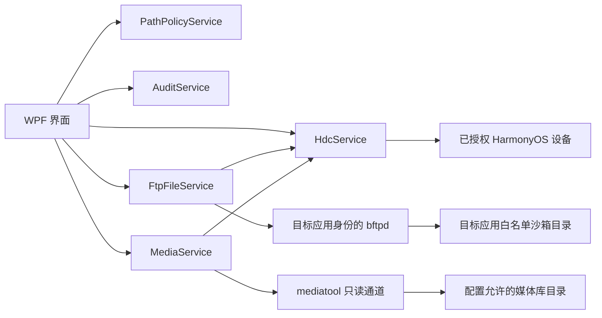
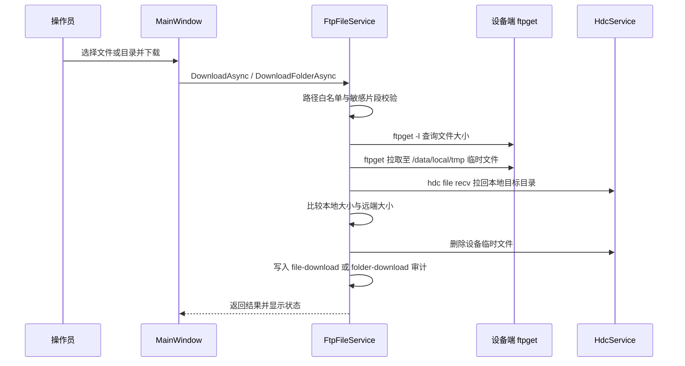

# 鸿蒙应用维护工具流程技术说明

## 1. 目的与适用范围

本说明对应 `HarmonyFileManager` 当前实现。工具是运行于 Windows 的 .NET 8 WPF 内部维护客户端，仅用于已获得授权的测试或企业设备，以及已在配置中登记的目标应用。

系统提供两条彼此独立的访问流程：

| 流程 | 目标数据 | 能力 | 受控边界 |
| --- | --- | --- | --- |
| 应用文件维护 | 目标应用自身沙箱的白名单目录 | 浏览、下载、上传、递归传输、删除 | 通过目标应用身份运行的 `bftpd` 访问；所有路径均通过白名单和敏感路径校验 |
| 相册/视频下载 | 配置允许的系统媒体库目录 | 浏览、批量下载、拖拽下载 | 仅使用 HarmonyOS 正式提供的 `mediatool` 只读能力；不提供上传、删除或修改 |

本工具不提供跨应用沙箱访问、设备绕过、敏感数据导出、媒体库写入或恢复功能。若目标应用为 release 签名，系统可能拒绝 `aa process` 启动维护服务；该限制属于系统安全边界，不应尝试规避。

## 2. 组件与职责

| 组件 | 职责 |
| --- | --- |
| `MainWindow` | 设备发现、应用沙箱目录导航、文件维护交互、破坏性操作确认与状态提示 |
| `MediaWindow` | 相册/视频分桶浏览、下载目录管理和只读媒体下载交互 |
| `HdcService` | 调用本机 `hdc.exe`，执行设备发现、设备端命令和临时文件收发；处理超时与 Windows 端进程清理 |
| `HdcToolchainLocator` | 按优先级在本机定位 `hdc.exe`：配置路径 → 工具自带目录 → OpenHarmony/HarmonyOS SDK → DevEco Studio → PATH |
| `HdcToolchainInstaller` | 从压缩包直链下载或本地压缩包解压安装 hdc 到工具 `toolchains` 目录，并做可执行性校验 |
| `HdcSetupWindow` | hdc 缺失时的引导窗口：自动下载、选择压缩包安装、手动指定、打开官方下载页 |
| `FtpFileService` | 启动应用身份的 `bftpd`，通过设备端 `ftpget`/`ftpput` 实现文件操作、完整性校验、重试和连接恢复 |
| `MediaService` | 通过 `mediatool` 列出、接收媒体文件，再通过 HDC 拉回本机 |
| `PathPolicyService` | 校验应用沙箱访问路径是否处于白名单内，且未命中敏感路径片段 |
| `AuditService` | 将设备和文件操作以 UTF-8 追加写入运行目录下的 `logs/audit.log` |



## 3. 配置与启动前校验

程序启动时从应用运行目录读取 `appsettings.json`，并反序列化以下配置：

| 配置段 | 关键字段 | 作用 |
| --- | --- | --- |
| `HdcPath` | `hdc.exe` 路径 | 设备命令执行入口；可留空由自动探测补齐，缺失时引导安装 |
| `HdcInstall` | 下载源、官方下载页、USB 驱动页 | HDC 引导窗口的可选配置（DownloadUrl 为空时改为手动安装） |
| `FtpAccess` | 起始端口、用户名、密码、`BftpdCommand` | 启动和访问设备端 FTP 维护服务 |
| `ManagedApplication` | Bundle 名、Ability 名、显示名 | 指定可维护的目标应用身份 |
| `ManagedApplication.AllowedRoots` | 逻辑根名到沙箱绝对路径的映射 | 目录选择器和访问白名单来源 |
| `ManagedApplication.BlockedPathFragments` | 敏感片段 | 命中即拒绝访问，例如偏好设置、令牌、密钥或数据库 |
| `MediaAccess` | 启用开关、媒体根、下载目录、媒体类型 | 可选的只读相册/视频下载功能 |

配置中的白名单应只包含业务维护需要的目录，且不得将偏好设置、凭据、令牌、数据库或其他敏感目录加入白名单。

## 4. 应用沙箱文件维护流程

### 4.0 启动前的 HDC 工具链解析

1. 主窗口构造时调用 `HdcToolchainLocator.Resolve`，依次探测配置的 `HdcPath`、工具自带/自动安装目录（`toolchains`）、`%LOCALAPPDATA%` 下 OpenHarmony/Huawei SDK（多版本时优先数值最大者）、DevEco Studio 自带 SDK 与 `PATH`。
2. 命中即写回运行目录 `appsettings.json` 的 `HdcPath`（保留其余配置），后续启动直接使用。
3. 未命中时主窗口加载完成后弹出 `HdcSetupWindow` 引导：可从配置的压缩包直链自动下载并解压到工具 `toolchains` 目录、选择本地压缩包安装、手动指定已安装的 `hdc.exe`，或打开官方下载页。
4. 自动安装与手动指定均先运行 `hdc version` 校验可执行性，通过才返回路径并写回配置；校验不通过或用户跳过时保持未配置状态，界面提示点击「HDC 设置」重试。
5. 主界面左侧提供「HDC 设置」按钮，可随时重新引导并重建 `HdcService`，写回 `hdc-setup` 审计。

### 4.1 设备发现与建立维护通道

1. 主窗口启动后每 5 秒执行一次轻量设备检测；用户也可手动刷新。
2. `HdcService.ListDevicesAsync` 运行 `hdc list targets`，解析设备 ID 和状态，并过滤 `[Empty]` 等占位输出。
3. 检测到设备且尚未建立连接时，界面自动尝试连接排序后的第一台设备。
4. `FtpFileService.ConnectAsync` 先尽力清理残留的 `ftpget`、`ftpput`、`bftpd` 及启动命令，避免上一次异常中断遗留连接。
5. 服务从配置起始端口开始，最多尝试连续 50 个端口。每个候选端口需同时满足：Windows 本机回环端口可绑定，且设备端没有同端口运行的 `bftpd`。
6. 通过 `hdc shell aa process -b <BundleName> -a <AbilityName> -p "<bftpd 命令>" -S` 以目标应用自身身份启动新的 `bftpd` 实例。
7. 等待后使用 `ps -ef | grep bftpd` 校验进程和端口；成功后将连接标记为可用，并写入 `ftp-connect` 审计记录。
8. 连接失败时，界面禁用维护操作并显示失败原因；审计记录为 `ftp-connect-failed`。

运行时不依赖常驻 FTP 控制连接，也不依赖端口转发。每次维护命令均由设备端短生命周期的 `ftpget` 或 `ftpput` 客户端通过设备侧 `localhost` 访问同设备中、以目标应用身份运行的 `bftpd`，以降低转发规则和长期连接不稳定带来的影响。

### 4.2 路径授权与目录浏览

1. 用户从配置的逻辑根目录中选择一个根，例如 `files` 或 `cache`。
2. 当前远程目录由所选根目录和相对导航路径拼接得到。
3. 在浏览、跳转、上传、下载、建目录和删除前，`PathPolicyService.EnsureAllowed` 执行以下判断：
   - 路径规范化为 `/` 分隔符并去除结尾 `/`；
   - 路径必须以任一 `AllowedRoots` 项为前缀；
   - 路径不得包含任一 `BlockedPathFragments` 项，比较不区分大小写。
4. 校验失败时抛出 `UnauthorizedAccessException`，界面显示“该路径不在维护白名单中或属于敏感数据”，不执行设备命令。
5. 校验通过后，设备端执行 `ftpget -l` 获取 Unix 风格目录列表。远程路径先 UTF-8 Base64 编码，在设备端解码，避免中文路径在命令传递过程中损坏。
6. `FtpFileService` 解析文件类型、大小和修改时间，返回完整沙箱路径；界面刷新表格、面包屑和选中状态，并记录 `file-list` 审计日志。

用户主动浏览会取消上一轮未完成的目录加载，避免陈旧结果覆盖当前操作。已连接状态下的自动刷新只检测设备仍在线，不会与人工文件操作竞争传输通道。

### 4.3 下载流程



单文件下载会先读取远端大小，再将文件拉至设备临时目录，最后通过 `hdc file recv` 保存到本机。若本地大小与远端大小不一致，操作失败并报告“下载不完整”。目录下载通过列表递归执行，并保留本地目录结构。批量下载会逐项处理，汇总成功数和失败原因。

拖出文件时，界面先将选中普通文件下载到桌面目录，再以 Windows `FileDrop` 数据格式交给资源管理器。该操作同样经过路径校验和下载审计。

### 4.4 上传流程

1. 用户选择本地文件，或将文件/文件夹拖入文件列表。
2. 界面计算远端目标路径，并在可能覆盖同名内容前弹出确认框；取消则不发送任何传输命令。
3. `UploadAsync` 获取 FTP 操作锁，校验远端目标路径后，先通过 `hdc file send` 将本地文件发送到设备临时目录。
4. 设备端以 `ftpput -s` 将临时文件写入应用沙箱目标路径。
5. 客户端轮询父目录列表中的目标文件大小；当大小连续两次等于本地文件大小时，视为传输完成。
6. 若文件大小长时间不变、命令超时或连接状态异常，系统记录 `upload-retry`，重启干净的 `bftpd` 实例后重试，最多 3 次。
7. 成功后记录 `file-upload`；无论结果如何，均尝试删除设备临时文件并刷新界面目录。

文件夹上传会先以 `ftpput -M` 逐级创建远端目录，再递归上传文件和子目录。对“目录已存在”的设备响应会继续执行下一级，不将其视为失败。

### 4.5 删除与重命名

删除是破坏性操作。界面在用户选中一项或多项后，必须显示“删除后不可恢复”的二次确认；用户取消时不调用删除服务。

确认后，服务持有 FTP 操作锁并清理可能残留的 `ftpput`。删除文件使用 `ftpput -d`；删除目录时先通过 `ftpget -l` 判断和递归清空内容，再使用 `ftpput -D` 移除目录。空目录采用文件删除和目录删除两种命令兜底，以适配设备端对文件/目录类型判断不稳定的情况。完成后记录 `file-delete`，并重建 `bftpd` 连接，隔离删除命令可能留下的连接状态。

当前设备端匿名 FTP 用户不允许 `RNTO`，`ftpput -m` 也受相同限制。因此重命名按钮只显示“不支持”状态，不执行任何远端改名操作。

## 5. 可选媒体下载流程

媒体窗口仅在 `MediaAccess.Enabled` 为 `true` 时可打开。该流程与应用沙箱维护服务隔离，不启动 `bftpd`，也不具备上传、删除或修改能力。

1. 窗口通过 `hdc list targets` 发现并连接设备，记录 `media-device-connect`。
2. 用户选择“相册”或“视频”类型，程序根据配置映射为设备端媒体目录。
3. `MediaService` 调用 `mediatool ls -l` 列出分桶和文件，并解析 ISO 格式时间。
4. 下载单个媒体文件时，调用 `mediatool recv` 将文件写入设备临时目录，再通过 `hdc file recv` 保存到本机下载目录。
5. 操作结束后清理设备临时文件，记录 `media-download`；批量下载另记录 `media-download-batch`。
6. 拖拽下载先并行准备至唯一的本机临时目录，再以 `FileDrop` 交给系统；结束后尽力删除临时目录。

若设备在自动检测中消失，窗口清除当前媒体连接、更新设备列表并写入 `media-device-lost`。媒体访问的前提是目标设备与系统能力已按正式运维流程授权；系统不尝试用普通 shell 直接读取受限媒体路径。

## 6. 超时、重试与恢复

| 场景 | 处理方式 |
| --- | --- |
| `hdc.exe` 不存在 | 启动时自动探测（配置路径、SDK、DevEco Studio、PATH），仍缺失则弹出引导窗口安装或指定，通过校验后才写回配置 |
| 常规 HDC 命令超过 30 秒 | 终止对应 Windows 端 HDC 进程并报告超时 |
| HDC 文件收发 | 使用 300 秒超时，适配大文件 |
| `ftpget`/`ftpput` 卡住或取消 | 记录 `device-cmd-abort`，清理同名设备端客户端进程 |
| 目录列表等短命令首次超时 | 重建 FTP 服务后重试一次 |
| 上传不完整或停滞 | 最多重试 3 次，每次使用新的 `bftpd` 实例 |
| 下载可能未完整写入 | 比较远端与本地文件大小，不一致即失败 |
| 设备断开 | 自动检测移除连接状态，禁用文件操作，记录 `device-lost` 或 `media-device-lost` |
| 列表请求被更新操作取代 | 使用取消令牌静默结束旧请求，保留最新用户操作 |

所有 HDC 标准输出和错误输出按 UTF-8 原始字节读取，避免中文文件名被系统 ANSI 编码错误解码。

## 7. 审计与运维要求

审计日志位置为运行目录下的 `logs/audit.log`，每行格式如下：

```text
<ISO 8601 时间戳>\t<动作名称>\t<详情>
```

已记录的关键事件包括设备发现与丢失、FTP 连接与失败、目录列举、文件/文件夹上传下载、删除、安装包安装与失败(hdc install)、媒体下载、重试和超时诊断。日志为本地追加写入，便于按时间、设备、应用包名和路径追溯操作。

运维人员应遵守以下要求：

1. 仅维护已授权设备和已配置的目标应用，不通过本工具扩展访问范围。
2. 修改 `AllowedRoots` 或 `BlockedPathFragments` 前应完成安全评审；敏感路径默认拒绝。
3. 上传覆盖和删除必须由操作员在界面确认，不通过脚本或其他方式绕过确认流程。
4. 对异常、超时或重试频繁的设备，应保留审计日志并排查设备状态、应用签名和 HDC 环境，不降低安全边界。
5. 对外导出的下载文件应按企业数据分级和保管要求处理。